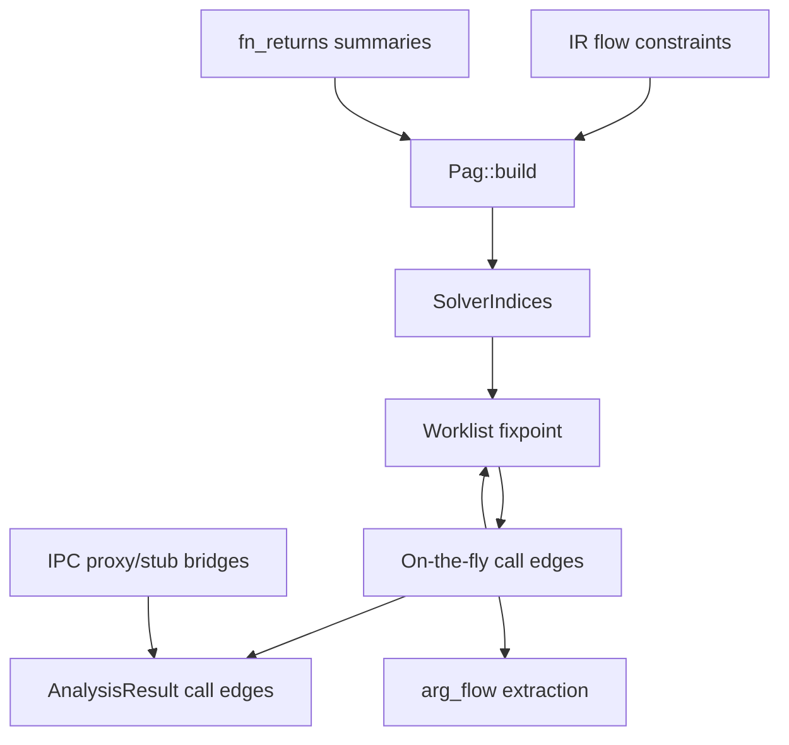

# Pointer analysis

trace uses inclusion-based (Andersen-style) pointer analysis to resolve indirect calls and wire interprocedural argument flow. This page covers the pipeline, symbol identity, link targets and merging, and is the entry point to the topical analysis documents below.

## Documentation map

The analysis documentation is split by aspect:

| Document | Covers |
|----------|--------|
| [Overall design](ANALYSIS.md) | Pipeline, properties, source locations, symbol identity, shared headers, link targets and merging. |
| [IR](IR.md) | Type and call-record storage, flow constraints, return-value flow, conditional values, casts, smart pointers and dynamic symbols. |
| [Pointers](POINTERS.md) | PAG, solver, field/array modeling, indirect resolution and argument wiring. |
| [C++ support](CXX.md) | Classes, templates, automatic objects, factories, syntax reuse and IDL interfaces. |
| [Models](MODELS.md) | Function models, IPC bridges, callbacks and execution contexts. |
| [User features](USAGE.md) | Value slices, sequencing, dependency roots, compilation databases, exploration and dataflow presentation. |
| [FAQ](FAQ.md) | Known imprecision, performance notes and recommendations. |

## Properties

| Property | Value |
|----------|-------|
| Scope | Whole-program C/C++; independent link-target scopes when build metadata is available |
| Flow sensitivity | **None** (control-flow insensitive) |
| Field handling | Field-sensitive with **instance-insensitive field summaries** |
| Pointer analysis kind | **May-analysis** (sound over-approximation) |
| Context sensitivity | **None** |
| Call order | Not used by the analysis; optional per-function control-flow sidecar ([Call sequencing](USAGE.md#call-sequencing-control-flow-sidecar)) |

## Workflow



1. **`Pag::build(program)`** — materialize PAG nodes/constraints from `program.flow`, expand `CallReturn` using `program.fn_returns`, attach indirect-call `Load`/`Copy` constraints.
2. **`solve`** — worklist propagation until fixpoint; discover indirect callees when call-target points-to gains function locations.
3. **`extract_arg_flow`** — emit `arg_flow_edges` for wired parameter copies at resolved calls.

## Call source locations

For a member call on a call result, the request position is the called
member token: `make().next().next()` has a distinct position for each
`next`. This also keeps repeated calls in a chain distinct during merge.
Ordinary member calls retain their receiver's start position.

A call token written in a source macro replacement list uses the token's
spelling location in the macro definition as `CallSite::span`. Its optional
`CallSite::expansion_span` identifies the outermost invocation that emitted the
token. This makes the spelling location usable as a source request while still
distinguishing repeated expansions of the same macro body. Calls spelled as
macro arguments keep the argument's own source position and have no macro-body
expansion span. For a member call whose called member is spelled in a
replacement list, lowering displays that member token rather than the
receiver's first token; therefore `ARG->member()` still points to `member` when
`ARG` came from a macro argument.

Displayed coordinates are not the call's merge identity. A receiver or member
argument may expand from another macro, giving several calls the same displayed
spelling and expansion pair. Macro member calls therefore retain a separate
internal occurrence identity from their replacement-list `.` or `->` token.
That identity contains the punctuation spelling, outermost expansion, and the
preprocessor's deterministic expansion-chain fingerprint. The chain preserves
intermediate helper invocations and parameter-substitution positions, so two
expansions of the same helper token inside one outer invocation remain distinct.
Merge and virtual-target deduplication use this occurrence identity; database
export and source requests continue to use `span` and `expansion_span`.

Semantic ownership and visibility use the expansion file when it is present.
Consequently, invoking a macro declared under a dependency root still produces
a call in project code, while a call actually expanded inside a dependency body
remains excluded. Post-merge virtual-target deduplication uses both spelling and
expansion spans, so repeated invocations of one macro-body virtual call each
receive overrides discovered in other translation units. `CallSite::scope_file`
is the shared source of this semantic file for name lookup, internal-overload
argument flow, synthesized-external ownership, and PAG resolution.

The SQLite `call_sites.file_id/line/col` columns export the spelling location;
the nullable `expansion_file_id/expansion_line/expansion_col` columns export the
invocation. These facts come from the preprocessor `LineMap`, including cached
header expansions. Macro definitions remain preprocessing metadata and never
become IR functions or methods. `trace inspect calls --file` matches either the
spelling file or expansion file and orders macro calls by their invocation.

Consumers choose displayed positions from these same stored facts. CLI inspect
shows the spelling position, including macro-body tokens. LSP call hierarchy
`fromRanges` must belong to the caller's document: `editor_calls` prefers the
outermost expansion position when it belongs to that file, then the spelling
position if it belongs to that file, and otherwise supplies no range. This
presentation choice never changes call identity or semantic ownership.

## Shared header functions

Ordinary indexing caches resolved top-level system include bundles as header
units as well as project headers. Only leading includes before project
declarations are separated, preserving incoming typedef and overload context
for later includes. A bundle includes its nested implementation
fragments; includes inside an unfinished declaration or scope remain inline.
Bundles containing project-owned implementation text also remain inline under
the ownership rule in the preprocessor contract below.
For system bundles, macro fingerprints, language and the preceding shared
system declarations select the consumed expansion. Its declaration preamble
imports prerequisite types and callable prototypes (including return shapes
needed by global initializers), even without another textual include. Lowering
schedules exact variants before their consumers. Only recorded matching system
variants enter a consumer's preamble; a cache-limit or scope fallback lowers its own inline
text. This uses the existing type/prototype merge and declaration-only dependency ownership,
including their approximation rules below. Namespace imports and weak pragmas
remain in consumer text through the conservative inline fallback described in the
preprocessor contract. Compilation-database indexing and
conditional recording/exploration retain inline system headers. See the
[preprocessor cache contract](PREPROCESSOR.md#shared-system-header-bundles).

Before lowering a source TU that consumes dependency headers, indexing caches
its assembled header preamble, keyed by the exact ordered header units (and
therefore their languages and expansion variants). A preamble contains the
existing types, declarations and shared-header facts before the TU's own source
is visited. Reusing an assembled preamble avoids merging overlapping header
tables again; recorded include relationships, function ownership and name
lookup selections are preserved directly. For settled ordinary system-header
indexing, a metadata-only pass selects
recurring complete preambles and shared prefixes before TU lowering. The
bounded plan favors the imports each additional checkpoint avoids, with source
order breaking ties. It retains up to 16 full/prefix snapshots, including useful
prefixes shorter than 32 units, and skips one-off combinations. Other paths
retain bounded first-use admission and prefixes at 32-unit intervals;
uncached combinations follow the same merge order so cache admission cannot
change output. The source file is interned after a reused preamble and then
lowered in its own context. Project source definitions are never selected from
a representative TU. Consumers still clone the mutable context: this is not
yet a lookup layer that borrows all declarations without importing them.
Inline fallback headers still lower within their consuming TU.
Runs without dependency headers keep the ordinary preamble path.

Standalone orphan headers settle before the final header-variant plan and
contribute their replayed variants and nested prerequisites alongside TUs.
Their bodies import cached declarations, including function return types,
rather than just type layouts; an orphan's header extension does not make its
own function bodies declaration-only. Cached project-header units import
system prerequisites as declarations too, including callable return shapes
needed by inferred initializers. Imports between cached project-header units
retain the existing types-only path; system bundles import prerequisite
declarations regardless of their origin.
Function dependencies of initializer constraints include selected reference
getter declarations. Missing function IDs are filtered before remapping, and
TU replay follows these dependencies. Replayed internal functions' returned
file-static cells retain their supporting initializers. Imported file-static
storage also receives its initializer when a default argument of an external
inline function is its only consumer; connected initializer temporaries and
address/function facts follow that storage.
An external header getter returning an internal C++ function retains the
TU's return binding when the getter body has already been merged. Otherwise
the shared body would lose its static callback as header-preamble merging
omits internal definitions until their TU replay.

Header-unit selection and dependency scheduling reject a different language
before consulting variant records, including the project-header fallback when
no variant was recorded. Project headers consumed in both languages retain
matching declaration units for both contexts. Their established body-owning
language, chosen by the existing indexing language decision, remains authoritative
in the final header merge; supplementary language units supply declarations and
diagnostics.
Preamble planning, TU lowering and header wave
scheduling use canonical graph paths for cache identity and include edges, so
symlink spellings cannot change the selected units or miss planned snapshots.

Separately lowered dependency-header diagnostics enter the final program with
their header unit, even though its bodies are excluded. Identical reports are
deduplicated across shared variants and are not copied into each TU's preamble;
sharing must not hide parser warnings about incomplete header parsing.

Dependency-header data declarations share storage during preamble import and
final merging when their original position, declared name, remapped type,
link image and declaration metadata agree. Each replay still updates ordinary
name lookup in import order. File-static objects retain their per-unit identity.
A function declaration that joins an existing signature reuses its parameter
variables when the signature keeps its existing parameter list. Old parameter
records from folded prototypes alias the surviving slot only when their types
agree; project function definitions retain their body bindings.

This section defines header-function sharing. `SymbolTable` owns visibility
and resolution: call consumers use `Program::callees_of` (or the symbol-table
equivalent), and name-based return facts use
`SymbolTable::call_return_candidates` / `return_flow_candidates`. Merge records
contributing contexts; analysis and export reuse those resolvers rather than
reconstructing the rules.

C++ internal-linkage definitions originating in an included header share one
function entry when their source position, name and exact preprocessed
definition text agree (#116), including lambdas nested in header bodies.
Different macro expansions remain separate. Text identity is the whole
test: a body whose meaning differs per unit through an earlier `typedef`,
`using` alias or `enum` constant is still one entry, and it keeps the first
contributing unit's parameter and return types. That is a known
approximation, not a separator. The comparison uses expanded text, rather
than original source or a hash alone, and does not depend on worker
scheduling. Deduplication is confined
to each link image; source-file definitions retain their TU identity.

The symbol table records the TUs contributing each shared definition, so it
is visible only in those units and their included files. Visibility uses
recorded include relationships, since included files can have arbitrary
extensions. Parameters and
body locals are shared, and merging unions distinct call, flow and return
facts. Base configurations and variants use the same shared-flow index across
TU families within a link image, including facts first introduced by a variant.
Identical call records retain all contributing lookup contexts and are
exported once; records referring to different TU-local callees or mutable
callback objects remain separate.
File-scope static variables (`FileStatic`, with no owning function) still
represent distinct objects per TU. Function-local static variables (`FnStatic`)
share the canonical body's abstract locations alongside its other locals.
C++ gives each TU its own such object; sharing these locations unions their
possible values as a deliberate may-analysis over-approximation.
Name-based return lookup considers every contributing TU with the usual
local-definition precedence: for matching external definitions, a TU that
defines the function selects its own definition; a TU without one considers
all matching definitions in its target. This is a context-insensitive approximation:
a shared helper can propagate values from any of its includers, while no
contributing binding is discarded. Internal definitions without expansion
metadata retain their existing merge behavior.

A header lowered as a unit of its own, from a stored expansion, holds its
internal-linkage definitions itself: their unit is the header, not an
includer, and every file that includes the header sees them. A unit that
replays the expansion has no copy of its own, and its call to the header's
`static` function binds to the header's. The same holds for a header whose
expansion could not be stored and whose text another header's entry holds
(`docs/PREPROCESSOR.md`, "An expansion that cannot be stored"): what it
defines is its own, never a body the holder shares, so a file sees it by
including the header, whichever entry holds the text.

Expanded definition text travels through `UnitIndex::internal_definitions`.
Cached-header replay retains it in the temporary TU preamble so
`program_into_unit` can transfer it to the unit. The final merge keeps the
header-deduplication index without copying text into a second
`internal_definitions` index. CLI and C API call `Program::release_merge_state`
after indexing and before analysis, releasing these merge-only tables in both
scoped and unscoped runs. Rust callers that will merge more units retain the
state until their final merge is complete.

### Database merger header copies

`trace-merge` has source coordinates and normalized signatures, but no expanded
body text or TU lookup contexts. It recognizes a source origin by the remapped
`(file_id, line_start, name, signature)` with a positive line number. This is a
source-based approximation: different preprocessing configurations at the same
origin cannot be distinguished by body text in the database.

External declarations at one origin deduplicate across input databases and
link images. A declaration shared by different targets has `target_id = NULL`
in the merged output; relinking uses the original input records and the
caller's target. Definitions additionally require the same remapped target
to deduplicate. Each image keeps its own function ID and outgoing calls,
even when the source origin agrees. `header_functions_deduped` counts rows
actually unified, so retained definition copies in distinct images do not
increase it.

Copies of one source definition are not a `MultipleDefinitions` collision.
For an external call, selected candidates from just one source origin use
`direct` resolution (or preserve `indirect` / `ipc`) and count as one resolved
call, while emitting edges to every selected image copy. This retains paths
through different image-local callees. Distinct source origins remain
ambiguous. Unknown source positions cannot establish shared identity.

File dependency ownership is unified before function ingestion. When any
input owns a shared file as project code (`is_dep = 0`), all function copies
from that file are project code in the output, including prototypes and
definitions that retain separate IDs. This preserves visibility under
`--exclude-deps` independently of image deduplication.

### Declaring-header eligibility

By default, bare-tree inference puts files below a `test`, `tests`, `mock`,
or `mocks` directory relative to the analysis root in the test partition
(`trace_ir::is_test_path`, a lexical test on canonical paths). This
fallback convention never removes translation units. Production includes do
not search inferred test directories or select test headers by basename: the
basename fallback takes a production match only when it is the one
production file of that name (`src/foo.h` beside `test/mock/foo.h` resolves to
`src/foo.h`). Explicit include paths and relative includes still work.
Production name lookup excludes test bodies unless the caller includes their
defining file. An ordinary header body looks names up from its own header,
which no unit indexes, so it asks its includers instead: the header sees
another file when some unit including it is or includes that file. A
production header asks only production units, so a test unit that includes
it lends it none of its own bodies or mocks. The
declaration-family rule below uses the same test. When that exclusion removes the nearest entry, the
single-result lookup answers with the first remaining body, not a prototype
registered ahead of it.
Test callers retain production candidates. Authoritative link images override
this convention. The preprocessor and resolver share this path classification;
a missing external dependency remains unresolved instead of acquiring a mock.

The default directory names can be replaced with repeated `--test-dir NAME`
options, for example `--test-dir test --test-dir mocks` or `--test-dir fakes`.
Names are literal, case-sensitive directory components, not glob patterns.
Empty names, `.`, `..`, path separators (`/` or `\`), and NUL are invalid;
repeated names are deduplicated in first-seen order.
`--no-test-partition` disables this convention entirely; it conflicts with
`--test-dir`. Use the opt-out for production shims under `mock/` or shipped
headers under `tests/`. Neither setting changes explicit include or link
ownership rules. `trace_ir::TestPartition` owns the effective name list (an
empty list disables it); `is_test_path` applies it consistently in include
discovery, preprocessing, and symbol lookup through the inference-root
configuration. Shared include-search caches distinguish policies.
The configured policy is
recorded in [`analysis_run.options_json.test_partition`](SQLITE_SCHEMA.md#analysis_run),
even when authoritative build metadata takes precedence.
The C API exposes the same settings through `trace_index_options` (see
[the C API](CAPI.md)).

For example, a simulator build may ship this implementation under `mock/`:

```cpp
// src/net/client.cpp
int SocketOpen(const char *host);
int Connect() { return SocketOpen("a"); }

// src/net/mock/socket_shim.cpp
int SocketOpen(const char *) { return 1; }
```

In a bare tree, the default run leaves `Connect`'s call external. Running
`trace analyze <root> --no-test-partition` instead produces a direct edge to
`socket_shim.cpp`. The same option allows a production `#include "foo_util.h"`
to find a shipped header under `third_party/foo/tests/` through inferred
search paths or basename fallback.

An excluded definition must not erase its caller's external edge. External
synthesis uses the shared resolver across all contributing translation units,
including internal callees reached from header macros. A call site the
contextual call resolver already binds, for example to an internal-linkage
function visible from its unit or from any unit contributing a shared header
call, is never bound to a synthesized external, so a header-static function
declared nowhere in the unit's lowered text still resolves. An external synthesized
after that lookup retains its result; it does not expand again by name into
a different production overload.
Unscoped C definitions in different inferred partitions also retain separate
identities, so a later test body cannot overwrite the production candidate.

For an ambiguous C++ member name, declaration provenance belongs to the exact
function identity, including its overload, and survives prototype/definition
merging. A definition's source file is not its declaring header. After target
scope and caller-TU ownership are respected, a caller with positive evidence
of a visible declaration family with a definition prefers that family over
known unrelated families. A visible prototype alone does not justify dropping
otherwise compatible definitions. Unknown provenance retains the existing conservative fallback;
when no family is visible, all otherwise eligible candidates remain. This
declaration-family rule does not itself filter C external functions or remove
competing definitions that share the same declaring header. The separate
bare-tree partition rule above still applies to those candidates.

The shared resolver applies this eligibility to direct calls, expansion of
same-signature definitions, and name-based return flows. Expansion preserves
the call's overload selection. Shared header calls union the results of their
individual contributing TU contexts, rather than widening each context.

**Lookup order in name buckets**

Internal-function and file-`static` variable name buckets are kept sorted by
file ID, equal-file function entries staying in registration order. A
first-match lookup therefore never walks a whole bucket: the own-file entries
form one contiguous run, and among the header entries the first accepted one
is already the lowest-numbered — the result the ordering rules call for.
Candidate lists switch to a membership set for deduplication only once they
grow past a threshold, and the ordered vector stays authoritative, so no hash
map or membership set decides result order.

An external that is already bound and is the only entry under its name cannot
resolve to an alternative definition — nothing else can be named — so the
candidate walk is skipped for it, prototype-only bindings included
(`is_sole_binding_of_name`). Resolution policy itself is unchanged: every
lookup still goes through `resolve_function_in_scope_in_target` /
`resolve_function_candidates_in_target` with the caller's target (invariant 5).
The solver resolves and wires call sites sequentially, in call-site order.
`TRACE_SOLVER_STATS` reports resolution separately from worklist time.

## Canonical variable identity

This section is the authoritative description of how a scoped variable is
identified and looked up; other sections link here instead of restating the
rules (see "Link targets and weak symbols" below for how an image unifies and
overrides globals by the external symbol name defined here).

`Variable::name` stays the token written at the declaration site — what
display and export show. `Variable::qualified_name` additionally carries the
canonical scoped spelling (`ns::ptr`, `outer::inner::ptr`, `Holder::member`,
`nest::Box::member`, no leading `::`) when the variable was declared at the
scope of a named C++ namespace — whatever its linkage, so a namespace
`static` is `ns::p` too, while a top-level anonymous namespace adds no
segment and qualifies nothing — or is a class's `static` data member; it is `None` for a local,
a parameter, a temporary, or anything declared at plain global or file scope,
so the ordinary case adds no allocation. `Variable::lookup_name()`
returns the qualified spelling when present, else `name`, and is what every
symbol-table index that identifies a variable by name keys on: `a::ptr`,
`b::ptr` and a bare `ptr` register under three distinct keys in
`global_by_name` / `target_globals` / `file_statics_by_name` instead of
colliding on `"ptr"`. No separate index competes with these three; canonical
identity only changes the key they are stored under.
`Variable::external_symbol_name()` gives that same string, but only for
`StorageClass::Global` — the one storage class that denotes a linker-visible
symbol. Internal-linkage variables are registered `FileStatic`: a file
`static`, a namespace `static`, a variable of an anonymous namespace
(`storage_for` in `trace-parse/src/lower.rs`), and a static data member of a
class declared in one. The exception is a C++ `const`/`constexpr` variable at
file or namespace scope, which has internal linkage but stays `Global` (see
the imprecision under "Link targets and weak symbols" below). So an anonymous
namespace's `hidden` is the file's own
storage in every unit that includes it, never an image's symbol named
`hidden`. `global_by_name`/`target_globals` are keyed by
`external_symbol_name()`, and image unification, weak strength, weak
propagation and `#pragma weak` all compare it (below). `is_namespaced` is
source metadata only, set exactly when `qualified_name` is; no identity
decision reads it.

`SymbolTable::variable_named_in_scope(canonical_name, file)` is the exact
probe over that identity: the file's internal (file-`static`) binding first,
then the unscoped external binding (`global_by_name`). It names no image:
its one caller is lowering, and link targets are assigned after lowering, at
merge time. It performs no fallback stripping: an unresolved `missing::name`
never retries as `name`. `SymbolTable::global_named(target, lookup_name)` is
the external part, for one image or (`None`) the unscoped partition; the PAG's
name fallback for a call through a variable asks it with the caller's image.
An image is indexed by linker symbol. Every declaration of a C-linkage
variable of one name, in any namespace, is the same variable, and the image
keeps one of them under the bare symbol, so `cb` and `ns::cb` both find it;
a qualified spelling falls back to its last segment only for a C-linkage
variable.

Lowering qualifies a namespace-scope global at registration with
`LowerContext::qualify`, the same enclosing-namespace-path helper
`qualify_decl` uses for function names. A variable declared with C language
linkage (`namespace ns { extern "C" CB cb; }`, or anything inside an
`extern "C" { ... }` block) keeps `ns::cb` for lookup but links by its bare
name: `Variable::c_linkage` makes `external_symbol_name` return `cb`, so it is
the same image symbol as a C or `extern "C"` definition of `cb` in another
unit, and `#pragma weak cb` weakens it. A nested `extern "C++"` restores C++
linkage. `extern "C" T x;` without braces declares `x`, as `extern T x;` does.
A later redeclaration or definition of the variable keeps the C linkage its
first declaration gave it (`extern "C" CB cb; CB cb = f;`). A static data
member never has C linkage, even when defined inside `extern "C"`. A
namespace variable whose first declaration this unit sees is qualified
(`extern "C" CB ns::cb;`, `ns` an opened namespace) takes the linkage
around it, as the unqualified declaration would. Lowering spells a C-linkage
variable by its qualified name: in one unit its bare symbol does not answer
lookup (in a linked image it does, above). A written reference that may be
qualified (`inner::ptr` inside `namespace outer`, meaning `outer::inner::ptr`)
resolves through `find_in_scope`'s existing class/namespace traversal, which
tries each enclosing scope's spelling as the canonical-name probe, innermost
first, the same way a type or function name resolves from the current scope;
outside any C++ class or namespace, an unqualified name takes the plain path:
the body's locals, then `variable_named_in_scope` (the file's own `static`
before an external global). That is the scope walk's precedence too, so the
two paths never disagree. Inside a class or namespace, an unqualified name
not bound by a local takes the traversal (`ptr` inside `namespace a`
reads `a::ptr` before `::ptr`; `member` inside `Holder`'s member functions
reads `Holder::member`). `lookup_var` in `trace-parse/src/lower.rs` is that one
lookup, and every expression position reaches it through `lookup_var_node`
for an `identifier` or `qualified_identifier`: values, assignment targets,
arguments (`&a::ptr` passes the cell as `&x` does; see [Argument flow](POINTERS.md#argument-flow)), returns
(`return a::ptr` copies, `return &a::ptr` returns the cell), stores through
pointers, call receivers, and indirect callees (`a::cb()` calls through the
variable, `ns::f()` on a callable object calls its `operator()`, and
`H::table[i]()` and `h.table[i]()` load the element). A variable the name resolves to takes
precedence; otherwise a
qualified name falls back to the function it spells (`&a::handler`), and an
unresolved one yields no flow. A scope written with template arguments
(`Box<int>::member`) designates no variable: stripping the arguments could
bind an unrelated one.

`using` brings namespace variables into scope as it does functions.
A `using ns::name;` declaration in a function body counts as a local: it is
asked right after the body's locals and hides everything outside the body,
functions included. Outside the body, `find_in_enclosing_scopes` walks the
enclosing classes and namespaces; a `using ns::name;` written in a namespace
declares the name there, so it is asked next, before the global scope. A
file-scope `using ns::name;` and then a `using namespace ns;` directive are
asked after the global scope (`ImportScope`; functions resolve in the same
order):
`using namespace OHOS;` makes `key` read `OHOS::key` and `Foo::inst_` read
`OHOS::Foo::inst_`. The innermost declaration or directive is asked first
(`LowerContext::directive_namespaces` for directives). Within one
declaration or directive, a relative spelling means the enclosing namespace's
entry before the global one: `using namespace A;` inside `Outer` asks
`Outer::A` before `A`. A globally qualified target (`using ::ns::x;`) means
`ns::x` only. A function of the name declared at file scope hides
what a directive brings in.

In a value (`out = name;`) and a bare call (`name()`), a declared name
shadows a function of the same name: a local, a parameter or a body `using`,
then an instance field read through `this` in a member body, then a variable
the lookup above finds, and only then the function, as a return already asks. `&name` asks
the same way, so `&x` takes a variable's address even where a function `x`
is visible. An instance field outranks a namespace or global variable of its
name; see [Implicit this member variable access](POINTERS.md#implicit-this-member-variable-access).

A function named as a value resolves the way a call's name does
(`resolve_function_named`): through the enclosing classes (their bases
included) and namespaces, innermost first, then what a `using` brings in,
then the spelling as written. So `cb_t H::cb = Handler;` and
`out = Handler;` in a member body take `H::Handler`, `out = f;` inside
`namespace N` takes `N::f` over a global `f`, and `inner::g` inside `outer`
is `outer::inner::g`. Every value position asks it: initializers, direct
initialization arguments, assignments, `&f`, arguments, returns, and stores
through pointers. A direct call's return flow records the function under
that canonical name (`N::get` for `get()` inside `N`), because it is expanded
after merge, outside the call's scope.

The scope walk runs only when it could find something. `SymbolTable` keeps the
set of last segments of every registered `qualified_name`
(`has_scoped_variable_leaf`). Outside every class and namespace, a name whose
last segment is not in that set takes the plain path with no walk and no
allocation. Inside one, it still takes the walk when a variable outside every
scope holds the name, so a nearer declaration can hide it, whether or not some
unrelated scoped variable shares the name. A qualified spelling whose leaf is
absent can only be `::leaf`, a plain global.

Not modeled:
- A namespace alias does not bring a variable into scope.
- A parenthesized declarator with a typedef'd type (`CB (H::cb) = f;`,
  `CB (x) = f;`) parses as an expression statement at file scope, so it
  defines nothing. That is a parser limitation, not specific to members.
- A qualified name does not search the named class's bases. `Derived::m` for
  a member declared in `Base` resolves to nothing. A member access through an
  object does search bases (below).
- Pointer-to-member objects (`int X::*pm`) and dependent template
  instantiations are out of scope.
- A class defined inside another declaration (`typedef struct T {...} T_t;`,
  `struct S {...} s;`) registers its static members, but neither its member
  function bodies nor its in-class initializers are lowered. That is a
  limitation of member lowering generally.

### Static data member storage

A class's `static` data member (`struct Holder { static int *member; };`,
and a union's, since a C++ union is a class) has
one shared storage for the whole program, not a per-instance slot, so it is
registered as a canonical `Variable` — the same identity mechanism a
namespace-scope global uses — instead of being swept into the class's
instance-field layout (`trace-parse/src/lower.rs`, `lower_struct_specifier`'s
field loop routes a `static` member to `register_static_data_member` and
`continue`s past the `fields.push` an ordinary field takes). Its canonical
name is `{class}::{member}` (`Holder::member`, `nest::Box::member`), keyed the
same way `register_member_prototype` keys a member function; `static` here
means "one shared instance", not the file-scope rule an ordinary `static`
declaration gets from `storage_for` — the member's `StorageClass` is `Global`
unless its class itself has internal linkage (declared in an anonymous
namespace), in which case it is `FileStatic`. Either way it is indexed by its
canonical name, so its bare name never claims a slot in `global_by_name` /
`target_globals`. A class that declares a static data member is C++-only, so a
data-only struct nested in another registers under its nested spelling
(`Outer::Inner`) rather than keeping a C file-scope tag. That keeps its members'
in-class keys equal to their out-of-class definitions' keys.

A member access that names a static data member (`h.m`, `p->m`, `this->m`,
or `d.m` for a member of `d`'s base class) is that member's variable, the
same storage `Holder::m` names. It is not an instance field.
`static_member_access` in `trace-parse/src/lower.rs` types the receiver and
probes `{class}::{member}`, then each base class. The value, store,
address-of and argument positions ask it before they take the field path.
An instance field never pays for receiver typing: the leaf pre-filter
(above) answers first. A call through such an access (`h.cb()`) calls through
the member variable, as `H::cb()` does, rather than a member function of that
name. The access also types a call receiver (`h.m.run()`), and `return h.m;`
returns the member's value. A field path through the member (`h.obj.cb`) is
rooted at the member's variable, as `Holder::obj.cb` is. A class's own
instance field or member function hides a base's static member of the same
name, and so does any such declaration nearer than an outer scope's variable
(a namespace's function hides it whether external or file `static`).
The scope walk stops there (`scoped_variable_unless_hidden`), so `d.cb()`
calls `D::cb`, not base `B`'s static callback. A hidden name reads no
variable, now or in the deferred end-of-unit pass; an instance field it names
is read through `this`, and a bare call through one in a member body
(`cb()`) loads `this->cb`, as `this->cb()` does, and a call through a path
rooted at one (`handler_->fn()`) is an indirect call through
`this->handler_->fn` (see [Implicit this member variable access](POINTERS.md#implicit-this-member-variable-access)). A reference member is
recorded as a reference binding, so `&H::ref` and `&h.ref` are the
referent's address. A callable member called through an object (`h.fun()`)
calls its class's `operator()`, as `H::fun()` does. Every declarator of one member declaration
(`inline static CB a = f, b = g;`) is its own member with its own
initializer.

**Member function pointer declarator classification.** A struct or class
member declared with a function pointer declarator (`void (*handler)(int, uint32_t);`,
with or without an in-class initializer `= nullptr`, array dimensions, or multiple
pointer levels) declares a data field, not a member function. `member_decl_is_function`
in `trace-parse/src/lower.rs` rejects function pointer declarators
(`is_function_pointer_declarator`, `declarator_is_pointer_to_fn`), preventing them
from entering member prototype registration and `program.symbols.functions`.
Instead, they are indexed into the struct's field layout with `TypeDesc::FnPtr`.
This ensures that field stores and loads through function pointer fields are
preserved in the PAG and analyzed via points-to flow. Declarator classification
distinguishes nested callback types (e.g. pointers to functions returning function
pointers, `void (*(*cb)(int))(double);`) from member functions returning function
pointers (`void (*get_handler(int))(int);`) by examining the declarator binding nearest
the declared identifier. A pointer to member function (`void (S::*cb)(int);`)
never reaches this classification as such: the parse input blanks its owner
(see [C++ parse-input normalization](CXX.md#c-parse-input-normalization)), so it is
an ordinary function-pointer declarator and the variable is named `cb`. A
project data-member pointer (`int S::* dm;`) is not rewritten; declarator
classification still traverses its pointer-bearing qualified name
(`pointer_type_declarator`) and indexes it as a variable binding, `S::*dm`,
while retaining ordinary qualified function names as terminals.

A member declared in-class and defined out-of-class (`int *Holder::member;`
or `int *Holder::member = &object;` at namespace scope) share one `VarId`:
lowering an out-of-class variable definition recognizes a scope-qualified
declarator (any name `parse_declarator_name` resolved through a
`qualified_identifier`, pointer- and function-pointer-wrapped ones included)
and probes `variable_named_in_scope` for the in-class entry instead of
allocating a second variable, the same way an out-of-class member function
definition reunites with its in-class prototype
(`SymbolTable::register_function`). The raw spelling is resolved to that
canonical key with `LowerContext::qualify_decl` — the same relative-to-
enclosing-namespace resolution an out-of-class member function definition's
name gets — so `Box::member` written inside `namespace nest { ... }` and
`nest::Box::member` written outside it key the same entry a nested class's
in-class registration used. On a match, the definition takes precedence for
`is_defined` and `span`, mirroring a function definition superseding its
prototype's span; a miss (no matching in-class declaration in this TU) falls
back to registering fresh storage under the canonical name rather than
dropping the initializer's flow facts. When the enclosing-namespace
spelling names no variable, the owner class is resolved through a
`using namespace` directive (`class_seen_from`), as for an out-of-class member
function definition. `using namespace OHOS; cb_t FooTest::proxy_ = f;` defines
`OHOS::FooTest::proxy_`, also in a unit that only forward-declares the class,
so it links with the member other units declare. The definition can be any
declarator form: initialized, uninitialized with a bare qualified declarator
(`cb_t H::cb;`), or direct-initialized (`cb_t H::direct(f);`) when the name is
a known variable. A known variable is always defined there, never declared
as a function: its arguments are looked up in the member's class, as a copy
initializer's are, and one that does not resolve passes no value. An `extern` qualified redeclaration (`extern CB n::cb;`) defines
nothing. `__attribute__((weak))` on the in-class declaration makes the member
weak, as it does on the out-of-class definition. A pointer-to-member declarator (`int *Foo::*pm`) is none of these
and registers as an ordinary variable. The definition's initializer looks its
names up in the member's class, as an out-of-class member function body does
(`CB I::target = source;` reads `I::source`). A weak definition
(`__attribute__((weak)) CB H::cb = f;`) makes the member weak. An in-class initializer
(`inline static int *member = &object;`) lowers once, in
`lower_class_definitions`'s member-body pass (the field-layout pass that
registers the member's identity has no mutable `LowerContext` to lower an
expression with), and its facts belong to the member's definition, so a strong
definition elsewhere in the image drops a weak one's initializer as it does
any weak global's. An `inline` member is a definition with or without an
initializer (`inline static CB cb;` is zero-initialized). Lowering has no link targets yet, so every probe here is
untargeted (`target: None`); cross-TU reconciliation (image unification and
weak selection) is the merge's job, not lowering's, and keys a member on its
external symbol name like any other global.

**Sharing across translation units without link information (#143).** While
no image scopes a symbol (`SymbolTable::has_target_scopes` is false — inferred
targets that stay informational never set it, and neither does a link database
whose sources match no indexed unit, which scopes nothing and so shares as an
unscoped run does), an externally linked static data member is one variable
per program: `merge_unit` keys it by
`Variable::external_symbol_name` in `SymbolTable::unscoped_static_member`,
populated by `add_variable` from `Variable::is_static_member` (set by
`register_static_data_member`, kept by an out-of-class definition, and gained
by a fallback definition whose owner resolved to a class, above), so a
callback stored in one unit (`h->cb = handler;`) is called in another
(`h->cb();`). Equal member names are then one storage even across unrelated
binaries or tests in the same tree.

Declaration and definition are one identity and precedence is
`definition_supersedes`: a definition fills a declaration, a strong definition
displaces a weak one, and equal strength keeps the first merged record; the
surviving record carries the definition's original file, line and column, its
remapped type, and the canonical `VarId` (`adopt_definition`, also applied
when a configuration variant of the same source turns the declaration into a
definition at the same site). Every contributing unit's initializer and writes
are unioned — a may-analysis, with no weak-initializer suppression without
image information. An anonymous-namespace member (`FileStatic`, no external
symbol) stays one variable per unit, and namespace-scope and C globals are
unchanged: they remain per unit without link information. With link targets,
`target_globals` per image governs exactly as before
([Link targets and weak symbols](#link-targets-and-weak-symbols)), and units
no image claims are not unified.

## Link targets and weak symbols

Without link targets, a C++ static data member is the one global that is
still unified across translation units; see
[Static data member storage](#static-data-member-storage), "Sharing across
translation units without link information".

`--link-commands PATH` selects a link commands database. Otherwise indexing
checks `link_commands.json` at the analysis root, then `build/`, then the
directory the selected compilation database was read from — an out-of-source
build keeps both databases together, away from the sources — and reads
link-only entries from that compilation database. CMake metadata is read
through the lexically last `index-*.json` File API reply — CMake's timestamped
names sort newest-last — and its referenced `codemodel-v2` objects in those
same three directories. The first candidate build root that supplies targets
is used; additional build roots are not combined, avoiding duplicate target
scopes. Stale, unreferenced target JSON files are ignored.

**Inferred GN targets (#120)**

When link commands (including compilation-database link entries) and CMake
metadata are absent, sorted `BUILD.gn` discovery infers targets from literal
source and dependency lists. Authoritative metadata takes precedence even
when malformed: its diagnostics must not silently trigger inferred ownership.
The reader recognizes OpenHarmony library, executable, unit-test, fuzz-test,
and module-test target forms and standard GN equivalents. `source_set` and
`group` contribute dependency membership; config, action, and `data_deps`
entries do not supply linked symbols.

GN is parsed as data. Local imports and literal variables are evaluated with
bounded recursion; enumerable conditional alternatives are conservatively
unioned. Each imported file is read and lexed once per run but evaluated at
every import, in the importing scope; build files are read in parallel and
evaluated in sorted discovery order. Relative paths are resolved at their declaring build file. `//`
labels use a real GN workspace root or an explicitly recorded OpenHarmony
repository prefix from project metadata; arbitrary path suffixes are never
used to guess ownership. A scope literal (`sanitize = { ... }`) is skipped as
one unknown value, and `set_defaults` is ignored unless it names `sources`,
`deps` or `public_deps`. A target name may be a literal or a variable holding
one. An unresolved target name, or an import that is missing on disk, is a
diagnostic that leaves the rest of the build file readable. Unknown
expressions, templates, toolchains, or local dependencies produce diagnostics. When any part of the inferred graph is
incomplete or any discovered translation unit has no inferred owner, every
target read — incomplete ones included, with dependencies only on targets that
were read — and its source membership are exported as observations,
but symbol resolution stays unscoped for the whole tree: isolating just the
known targets would hide their definitions from unassigned callers. External
dependencies are not rebound to similarly named local targets. Incomplete
inference must not discard valid calls by pretending a partial image is a
complete one.

Known source/dependency membership feeds the existing target merge and
`link_targets` / `target_sources` export; inferred outputs are stable synthetic
identities, not claims that an artifact has been built. A source shared by
several targets receives separate image instances. Unassigned code remains
unscoped. The IPC process-boundary exception below applies unchanged.

Compilation object outputs (`output` or `-o`) identify both the source and
its compiler configuration. The same source built with different macros for
two targets therefore keeps those configurations separate. CMake source
membership without object/configuration information conservatively includes
all available commands for that source. Explicit artifact inputs and known
`-L`/`-l` target outputs establish dependencies; library lookup stops at the
first matching search directory. Commands are parsed as data;
no compiler, linker, or shell is executed. Unsupported command features and
unmapped objects produce diagnostics. Response-file expansion is bounded, and
runs after `-Wl,`/`-Xlinker` forwarding is unwrapped, so a file handed to the
linker as `-Wl,@objects.rsp` contributes its objects like a bare `@objects.rsp`.
A backslash before a newline splices the two lines, as in a shell.
Options are distinguished from inputs before extensions are consulted, so an
soname, a Darwin loader path (`@rpath/...`, `@executable_path/...`, which share
`@` with response-file syntax), an `-install_name` operand and MSVC switches
such as `/implib:foo.lib` are not read as link inputs, and `/out:` is matched
case-insensitively.

The IR stores `LinkTarget` records with typed `TargetId` values, direct sources,
and dependencies. CMake edges identified as build-order-only (`add_dependencies`)
do not import symbols; actual link relationships are retained even when an
ordering dependency also exists. Each target gets a separate symbol scope containing its
sources and transitive dependencies. Cycles terminate through a visited set.
Units are lowered once per compiler configuration and reused during merging;
weak body/initializer ownership is collected only when link metadata requires
selection, so ordinary indexing does not allocate those range maps;
a source shared by targets has distinct function and variable instances in
each scope. Unmapped sources remain in an unscoped partition. Without link
metadata, the existing indexing and whole-program merge path remains in use.

GNU `weak`/`__weak__` attributes (including C++ `[[gnu::weak]]` and
`[[gnu::__weak__]]`) and active `#pragma weak name` mark functions
and variables *with external linkage*. The `_Pragma("weak name")` operator
spelling is **not** read — a weak body annotated that way is not suppressed, so
both bodies' facts survive (over-approximate, not wrong). The alias form,
`#pragma weak name = target`, marks `name` weak but does not model the alias:
no flow is emitted from `name` to `target`, so a `name` with no definition in
the unit stays unresolved rather than resolving to `target`'s body. Otherwise: a `static` function, a local, a
parameter and a block-scope variable have no linkage to weaken, and the
annotation is recorded on none of them. An attribute among a declaration's
specifiers reaches every declarator it introduces, while one written inside a
declarator reaches only that declarator
(`void a(void) __attribute__((weak)), b(void);` weakens `a` alone). Within a target, a strong definition replaces a matching weak
definition; strong declarations alone do not suppress a weak body. Selection
uses the IR symbol registration/signature rules, including C++ overloads,
rather than a separate signature comparator. An overridden weak definition is
demoted to a declaration of the same symbol: it keeps its signature, which is
what tells one overload of a name from another, and contributes no local
variables, calls, return flows, or constraints, including writes to globals. Weak global initializers are excluded when a strong global definition
exists. Source origins follow the same occurrence suppression before provenance
is unioned by constraint identity: a surviving assignment with the same flow
constraint does not retain an overridden initializer's or weak body's operation
site. Surviving occurrences keep their original provenance order, and weak-only
targets retain the fallback's origins. Lowering records origin indices only
when weak/link selection needs occurrence ownership; source expression strings
remain shared in the constraint's ordered origin list.
A C tentative definition (`int x;` with no initializer) counts as a
strong definition and overrides a weak one, matching `-fno-common`, the default
since GCC 10 and in Clang. Under `-fcommon` a tentative definition is a common
symbol that a weak definition would outrank instead; the compiler flag is not
modeled, so that configuration resolves the other way here.

Globals unify within a target by their external symbol name
(`Variable::external_symbol_name`, see "Canonical variable identity" above):
the plain name for C, the canonical qualified name for a C++ namespace-scope
global or static data member. One external symbol is one variable per image,
so a caller's `a::cb` and another unit's definition of `a::cb` are one
variable, while `a::counter` and `b::counter` stay two and neither unifies
with a plain `counter`. Weak strength and weak propagation key on the same
name: a strong `a::cb` supersedes a weak `a::cb` in its image, never a weak
`b::cb`. A `#pragma weak` word is compared with that name, so `#pragma weak
cb` weakens `::cb` and never `app::cb`. An internal-linkage variable has no
external symbol name and takes part in none of this: each unit keeps its own
copy, even of one declared in a shared header.
Weak-only targets retain the fallback. Equal-strength weak function definitions from different origins
are selected deterministically in unit order; configurations of the same weak
body retain their union of facts. Weak global alternatives may conservatively
contribute multiple initializer values.

Target identity travels through direct calls, function addresses, transitive
returns, indirect calls, dynamic symbol lookup, and field summaries. Types
and immutable string literals may be shared, while mutable storage summaries
remain within a target. The same target-aware name resolver serves call and
return wiring; a lookup that names no image (the public resolver entry points)
still sees every symbol, which is not the same question as naming the unscoped
partition explicitly.

When separate translation units contribute distinct strong definitions of a
C++ function with the same qualified name and signature (such as multiple
implementations across modules analyzed in whole-program or unscoped mode
without link metadata), each definition is indexed separately in the symbol
table and the exported database.

Call-site resolution respects translation-unit boundaries:
- A translation unit that contains a definition of the function resolves direct
  calls exclusively to its own definition, avoiding duplicate edges from other
  units.
- A translation unit that does not define the function (seeing only declarations
  or prototypes) treats all matching definitions across the program as equal
  candidates and resolves to them. A call its unit ranked into one site per
  overload (`SymbolTable::index_overload_sites`) does not count an overload a
  sibling site binds as one: that is another function whose parameter types
  merely read alike (constructors taking two enum classes). Definitions that
  different units selected by `#if`, free or member, never share a call's
  sites and stay candidates.

**IPC bridges are the deliberate exception.** A Binder call crosses a process
boundary, so a proxy and the stub it dispatches to are in *different* images by
construction — a client executable and its service daemon. Proxy/stub pairing
and the synthetic edges it produces are therefore matched across the whole
program and are never filtered by target; they are the one kind of
`call_edges` row whose endpoints may differ in `target_id`. See [SQLite schema](SQLITE_SCHEMA.md) for exported weak flags
and target associations.

Link metadata needs a source for each object: either a compilation database
that names the object (`output`, or `-o` in its arguments), or link lines that
name sources directly. `--link-commands` on its own, against a project with no
compilation database, leaves every target with no sources and reports one
diagnostic per unmapped object.

A `-l` name resolves against known build outputs, including a versioned soname
(`-lfoo` finds `libfoo.so.1.2.3`). MinGW `libfoo.dll.a` and MSVC `foo.lib`
import libraries are not matched, and an unresolved `-l` is silent by design —
it is assumed to be a system library.

One further imprecision appears only under link metadata: a C++ `const` or
`constexpr` variable at file or namespace scope (not `extern`, not `inline`)
has internal linkage but is registered `Global`, so it is unified by its
external symbol name across translation units of one image like any other
global — `KEY` at file scope, `ns::KEY` in a namespace; both values merge, so
nothing is dropped, but the two are not kept apart as they are without link
metadata.

This models declared target membership, not a complete platform linker:
archive members are conservatively included, without demand-driven extraction;
link order, symbol versions, visibility, loader interposition, linker scripts,
and dynamically discovered DSOs are not emulated. A weak alias pragma marks an
existing declaration and synthesizes no body (see `PREPROCESSOR.md`), so the
alias resolves only if something else defines it. A multi-config CMake
reply repeats each target once per configuration, differing only in artifact
path; only the first configuration is read — indexing every one would repeat
the same facts at N times the cost — and a diagnostic names the ignored
configurations. Missing metadata cannot establish which independently built
image a symbol belongs to.

## Cross-repository callgraph reconstruction (`trace-merge`)

Large multi-repository software systems (such as OpenHarmony or Android subsystems) are organized and built as distinct repositories with separate build configurations, include paths, dependencies, and git trees. Running whole-program static analysis across multiple separate repositories simultaneously is intractable due to incompatible build roots, header namespace collisions, and massive memory footprints.

Instead, `trace` decouples intra-repository static analysis from cross-repository linking via the `trace-merge` tool:

1. **Intra-repository analysis**: Each repository is analyzed separately using `trace analyze`, producing a standalone SQLite database containing its callgraph, internal/external function definitions, call sites, and intra-repo points-to/dataflow facts.
2. **Cross-repository merge (`trace-merge`)**: Merges multiple per-repository SQLite databases into a unified database, reconstructing the cross-repository callgraph without running static analysis or dataflow solvers during the merge phase.

When implementation sources are available, prefer indexing each application,
framework and service repository into its own database, then merging the results.
The [README cross-project example](../README.md#cross-project-analysis-with-framework-sources)
shows the complete analyze/merge/query workflow and a call-chain depth that
covers the DataShare framework route. For partial checkouts, choose among
[declarations and explicit IPC fallbacks](MODELS.md#datashare-sources-and-fallbacks).

### Invariants and linking rules

- **No analysis during merge**: Andersen pointer analysis, PAG construction, and interprocedural dataflow solvers do **not** run during the merge stage. Intra-repository dataflow facts (`flow_nodes`, `flow_edges`, `arg_flow_edges`) remain strictly within their original repository databases. The merge stage is purely a deterministic linker that reconnects external call edges across repositories. Its shared-schema output leaves flow tables empty and call-site variable bindings NULL; see the [merger output contract](SQLITE_SCHEMA.md#merger-inputs-and-output).
  Existing indirect and IPC edges carry over. New exports also retain compact
  linking facts: declared classes and aliases, inheritance and template bases,
  method signatures/virtual flags, IPC senders and IDL identities, and member
  call receivers. After ordinary symbol linking, the merger combines these
  facts, expands virtual calls to newly indexed overrides, and runs the same
  pure IPC detector as analysis. New bridges have resolution `ipc`, no source
  call site, and an `ipc_handler` execution context. IPC matching crosses link
  images; ordinary member recovery stays in its caller's image or recorded
  dependencies when **both endpoints** have known image ownership. A targetless
  callee remains a possible target for a caller with an image; missing link
  metadata cannot establish that it belongs to an unreachable image.
  Source declaration certainty, defining analysis origins and the shared
  identity of an invocation's CHA
  alternatives are retained: ordinary recovery adds newly available
  definitions, without re-expanding every existing intra-repository call.
  An unresolved bare external call inside a known class also retains its
  possible implicit receiver; the combined hierarchy can recover an inherited
  member that was unavailable during lowering. Interface lookup through an
  unavailable `IRemoteStub<I>` definition shares the IPC detector's template
  argument recovery. Overload, nonvirtual and final rules apply without
  propagating values across repositories. Provider source views retain class
  and method finality separately. Virtual dispatch uses each provider image's
  visible bodies and final boundaries before unioning its targets; a final
  member or class in another image cannot cut off this view's descendants.
  A final static receiver known in the caller's own source remains a boundary.
  These views survive flat, staged and overlapping merges. Dispatch follows
  the selected
  overload's virtual/final flags: a virtual namesake cannot turn a selected
  nonvirtual overload into a virtual call. An undeclared receiver's generated
  external placeholder does not establish nonvirtual dispatch; its uncertain
  status still permits recovery through the combined hierarchy. An explicit
  call already bound to a defined nonvirtual body (or an exact/final binding)
  keeps that binding; another repository's same-name body does not widen it.
  Parameter mismatch excludes a candidate only when both selected and candidate
  arities are known. Parameter shapes retain guessed-tag names and their
  source uncertainty; a class declared in another provider cannot turn a
  caller's unresolved typedef into a certain class. The shared signature
  matcher admits scalar-typedef alternatives for such guesses. Legacy exports
  conservatively infer guesses for undeclared parameter tags. A method
  recovered through an unavailable `IRemoteStub<I>` remains a candidate when
  the indexed dispatch hierarchy supplies no targets. Unresolved arrow/field
  spellings with a known receiver are normalized in new linking facts; readers
  also recover the method from legacy spellings such as `p->Run`.
  Implicit-member recovery also runs when merging a **single input**: the merged
  graph can therefore contain inherited-member edges that the source analysis did not produce.
  First-time analysis origins are qualified by the input's database content
  identity, rather than using its root path alone. Different snapshots indexed
  at the same path (for example `/workspace/repo` in independent CI jobs) remain
  distinct; repeated snapshots retain the same origin. Already merged inputs
  preserve their inherited origins, including legacy path-only origins. An
  older merged database cannot recover distinctions it already lost; merge its
  original analysis databases again to obtain snapshot-qualified origins.
  These facts are retained by merged outputs for subsequent merges. Inputs
  sharing an inherited source site contribute its linking call fact once;
  reconstructed edges use the same [stable identity](#stable-merged-call-edge-ids)
  as retained edges across reordered, staged and overlapping merges. Retained
  aliases, template-base facts and IDL interfaces are sorted and deduplicated,
  so input order and overlapping stages do not append duplicate facts.
  Calls are sorted by remapped call-site ID before writing ordinals and
  allocating shared dispatch queries. Function and call-site IDs remain local
  to each output; cross-output edge identity follows the stable-ID contract.
  Conflicting targets for one alias remain present in canonical order; the
  shared resolver's last-wins rule is deterministic, without combining targets.
  Inputs without these facts remain supported, with a diagnostic reporting
  incomplete reconstruction. No new callback requiring cross-repository pointer
  flow is discovered. `--no-ipc` inputs contribute no IPC sender facts; their ordinary
  member linking facts remain available. Recovered member definitions use the
  ordinary linker's shared signature, strength and image preference rules:
  a weak body cannot be reintroduced after a matching strong definition wins.
  Strength competes within a signature; distinct weak overloads remain possible.
- **Execution contexts carry over**: `execution_contexts` rows are copied with their function and call-site ids remapped, and one whose function or call site did not survive the merge is dropped. A context a call site starts enters what the edge from that site to its entry now goes to: the definition another repository holds of a callback this one only declares (the callback edge is re-linked to it, and so is the context), or each candidate of an ambiguous edge, one row per candidate. `receiver_var_id` is NULL in the merged database, which carries no variables. Rows several inputs contribute for one context (same start, modelled callee, parameter, entry, kind and model: an IPC handler or an override entry a shared header defines, distinctly analysed header copies keep their call sites; repeated inherited occurrences coalesce under the stable identity contract) are kept once, with the evidence of all: `self_concurrent` when any input says so, and the first `multi_instance` that applies in the analysis' order. Merged rows are ordered as `trace analyze` orders them, by call site, then the entries no call site starts by entry. The evidence is otherwise each input's own: a cross-repository edge re-linked here is not searched for new cycles or parents ([Execution contexts](MODELS.md#execution-contexts)). Which inputs supply the table, and what an input exported before it contributes, is part of the [merger output contract](SQLITE_SCHEMA.md#merger-inputs-and-output).
  In particular, a newly reconstructed IPC handler has `self_concurrent = 1`,
  but that evidence is not propagated to contexts started by its reachable code.
  A worker thread started below such a handler may keep
  `multi_instance = 'unknown'` and `self_concurrent = 0` after a merge, while analyzing all sources
  together can establish `multi_instance = 'parent'` and `self_concurrent = 1`.
- **External call re-linking and may-analysis over-approximation**:
  - In individual repositories, calls to functions declared but not defined in that repository are emitted with `resolution = 'external'` (or point to `is_defined = 0` declarations). `trace-merge` matches these calls against exported strong definitions (`is_defined = 1`, `linkage = 'external'`) from other repositories, updating `call_edges.callee_fn_id` to the survivor's unified ID and retargeting `resolution` to `'direct'` (or `'ambiguous'` if conflicting definitions exist), while preserving original non-direct resolutions (`indirect` and `ipc`). Unresolved external calls retain their original resolution.
  - When multiple distinct source definitions exist across different repositories (or multiple weak definitions from distinct origins), `trace-merge` emits an ambiguous edge (`resolution = 'ambiguous'`) to **every candidate definition**, satisfying the may-analysis invariant (AGENTS.md §2). Copies of one source origin retain every selected image's edge with a resolved classification; see [Database merger header copies](#database-merger-header-copies). This ensures downstream path queries such as `trace inspect callchain` do not miss valid paths.
  - Recovery is conservative when multiple inputs contain independent copies
    of the same classes: calls and proxies can link to every compatible override
    and stub in other snapshots. Reconstructed edge counts can therefore grow
    faster than the input count. The terminal's `merge complete` line reports
    both added IPC bridges and member calls; the same counts are retained in
    `analysis_run.options_json` as `ipc_bridges_added` and `member_calls_added`.
  - Edges are deduplicated per call site on `(call_site_id, callee_fn_id)`, eliminating duplicate edges when an intra-repo direct or indirect edge and a re-linked external edge reach the same callee.
- **ELF linker semantics**:
  - `static` / internal-linkage functions are strictly kept file-local and are never exported for cross-repository resolution. An unresolved internal declaration also stays local: a same-name external definition cannot satisfy it.
  - Strong definitions (`is_weak = 0`) supersede unscoped weak definitions (`is_weak = 1`) across repositories. If an external call in Repo A binds to an unscoped weak fallback in Repo A, but Repo B supplies a strong definition for the same symbol and signature, the caller in Repo A is retargeted to Repo B's strong definition. Calls already bound to defined weak functions in a known link target retain that image's selection; definitions in another image do not override them or produce `WeakOverride` diagnostics for them.
  - For exact-signature matches with competing strong definitions, the caller's known target takes precedence when it supplies candidates. All candidates within that target remain reachable; the merger never arbitrarily selects the first definition. Without a candidate in that target, cross-repository matching is conservative: distinct original images remain separate after inherited copies coalesce, and the merger does not infer new target-dependency links between inputs. The caller's canonical function supplies target ownership, including when older merge metadata cannot identify its repeated target rows.
- **Header deduplication and dependency tracking**:
  - Shared files deduplicate by path, declarations share source identity across targets, and definitions retain image ownership. Project-file ownership propagates to every function copy, preserving `--exclude-deps` visibility. The authoritative rules, including shared declarations' target metadata and the deduplication counter, are in [Database merger header copies](#database-merger-header-copies).
- **Signature-aware C++ overload disambiguation and normalized matching**:
  - `trace-db` exports normalized parameter signatures in `functions.signature` (e.g. `process(int)`, `process(double)`). Top-level array parameters decay to pointers (`int[]` -> `int*`), while qualifiers (`const`, `volatile`) and signedness are dropped.
  - `trace-merge` groups exported definitions by `(name, signature)` before collision detection. Valid C++ overloads do not trigger false `MultipleDefinitions` warnings.
  - Calls to overloaded external functions first match candidates by exact signature (`orig_callee.signature == candidate.signature`). If no candidate matches by exact signature, `trace-merge` over-approximates by falling back to every same-name candidate rather than dropping the call, preventing lossy spelling discrepancies from stranding calls as unresolved.
  - When candidates originate from the same-name fallback rather than an exact signature match, `trace-merge` retains every selected candidate rather than applying same-database/same-target preference (which applies only to conflicting definitions of the same overload). Distinct source origins make the call ambiguous; copies of one source origin retain a resolved classification as described in [Database merger header copies](#database-merger-header-copies).
  - Strong-over-weak preference applies separately to each signature in the fallback pool. A strong `query(int)` cannot suppress a weak `query(double)` when either could match the call.
- **Problem detection and diagnostic reporting**:
  - `MultipleDefinitions`: Multiple strong definitions with the same signature and distinct source origins found across different repositories. Shared-origin image copies do not constitute a collision. Reported as a collision warning and recorded with `stage = 'merge'`.
  - `UnresolvedExternal`: External function references that have no matching definition in any merged database.
  - `WeakOverride`: Diagnostic informing that a weak definition in one repository was overridden by a strong definition from another repository. Intra-repository weak overrides do not trigger warnings.
  - `MissingExecutionContexts`: An input has no `execution_contexts` table (it was exported before the table existed), so it contributes no execution contexts. Recorded as an `info` diagnostic with `stage = 'merge'` naming the input.
- **Referential integrity and safety**:
  - Staging inserts and remapping are verified using `PRAGMA foreign_key_check` before transaction commit, ensuring zero orphaned foreign keys in `call_sites`, `call_edges`, or `target_sources`.
  - Rejects attempts to write output to any path matching an active input database.

### Stable merged call-edge IDs

`trace-merge` assigns `call_edges.id` from edge identity, independently of
input order, edge emission order and the other databases being merged.
An existing edge retains its ID when unchanged input databases are added or
reordered, including when a new candidate changes its `resolution` from
`direct` to `ambiguous`. Resolution is an attribute, not part of identity.
If linking replaces a declaration or weak definition with a different callee,
that is a different edge and receives a different ID. Function, call-site and
other row IDs remain local to each output database.

Identity version 1 uses SHA-256 with a domain string and length-prefixed byte
fields (lengths are unsigned 64-bit big-endian integers). An input's namespace
hashes its 32-byte [database content identity](SQLITE_SCHEMA.md#database-identity)
under `trace-merge-input-v1`. Current producers persist that identity; the
merger computes it read-only for older inputs. Database filenames and
canonical filesystem paths do not participate. Copies with the same database
identity are duplicate inputs and contribute once. Canonical paths still
guard against overwriting any input and recognize repeated filesystem names.
A call occurrence hashes the input namespace and its
original call-site ID under `trace-merge-call-site-v1`; this keeps repeated
macro calls and otherwise identical source positions distinct. Function
identity follows [database merger source deduplication](#database-merger-header-copies):
path, starting line, name, normalized signature and declaration/definition
status under `trace-merge-source-function-v1`, plus the original input namespace
and target ID (hashed under `trace-merge-target-v1`) for an image-owned body.
Declarations ignore images. Functions without a deduplicable source origin,
including internal functions, use the input namespace and original function
ID under `trace-merge-local-function-v1`. All row IDs and source lines in
identity fields use signed 64-bit big-endian encoding; definition status is
one byte, zero or one, and absent target/call-site identities are empty fields.

The edge hashes the caller, callee and optional call occurrence identities
under `trace-merge-call-edge-v1`. The first eight digest bytes, interpreted
big-endian with the sign bit cleared, become the nonnegative SQLite INTEGER
ID. Synthetic IPC edges have no call occurrence and use their final rebound
endpoints. The merger checks complete digests for numeric ID collisions and
fails before publishing output rather than assigning an input-dependent
replacement. Repeated copies of the same edge identity are emitted once.

Merger-only tables retain the full 32-byte identities of targets, functions
and call sites; see the [schema contract](SQLITE_SCHEMA.md#merged-identity-metadata).
A subsequent merge reuses them, preserving IDs even when an intermediate
merged database is renamed. Overlapping inputs, such as `A + merge(A, B)` or
`merge(A, B) + merge(B, C)`, map each repeated identity to one row before
linking and edge deduplication. This includes internal and positionless
functions. Incoming edges, outgoing edges, execution contexts and call-order
graphs all use those canonical references, so deduplication cannot strand a
caller's copy of a function without its outgoing edges. Target source and
dependency rows are unioned. Distinct original images and distinct call
occurrences remain separate.

Earlier stable-ID outputs with function/site identities but no target
identity table still canonicalize their function/site endpoints; their targets
use the input namespace fallback. Inputs without any identity metadata
establish every identity from their database content namespace. This does not
change the existing linking rules or promise that nested and flat merges
select identical edges; it preserves the identity of edges both produce.
Moving, renaming or copying original or merged databases
preserves edge IDs. Stability does not cover re-analysis or source edits.
The first merge with this version replaces the old sequential edge IDs.
